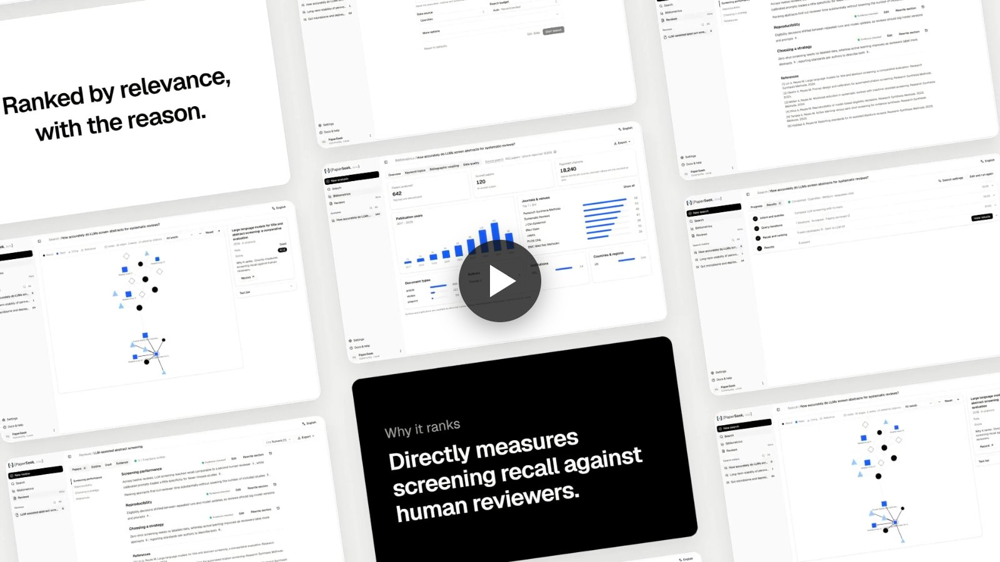

<div align="center">
  <h1>
    <picture>
      <source media="(prefers-color-scheme: dark)" srcset="docs/public/paperseek-lockup-dark.svg">
      
    </picture>
  </h1>
  <p><strong>从问题出发，找到研究的线索。</strong></p>
  <p>开源文献检索、初步文献计量与基于摘要的文献综述。</p>
  <p>
    <a href="LICENSE"></a>
    
    
    
    <a href="https://modelscope.cn/studios/HongMingfeng/PaperSeek"></a>
  </p>
  <p><a href="https://paperseek.app/">在线体验</a> · <a href="https://docs.paperseek.app/zh/">使用文档</a> · <a href="#快速开始">快速开始</a> · <a href="README.md">English</a></p>
</div>

---

[](https://paperseek.app/)

PaperSeek 将研究问题整理为阅读清单：构建并迭代检索式，从所选学术数据源召回候选文献，在支持时扩展引用，再按问题相关性排序。你可以查看检索过程、探索文献联系、保存结果，并从选中的摘要证据继续撰写综述。

可以在自己的电脑或服务器运行社区版，也可以直接打开 [PaperSeek 在线版](https://paperseek.app/)。自由选择模型 API，通过 Web、命令行、HTTP API 或 MCP 接入。

## 目录

- [为什么使用 PaperSeek](#为什么使用-paperseek)
- [1.0.0-beta 的变化](#100-beta-的变化)
- [工作流程](#工作流程)
- [数据源](#数据源)
- [快速开始](#快速开始)
- [模型与排序](#模型与排序)
- [综述实验性](#综述实验性)
- [社区版与在线版](#社区版与在线版)
- [CLI、MCP 与 API](#climcp-与-api)
- [Agent Skill](#agent-skill)
- [文档导航](#文档导航)
- [架构与贡献](#架构与贡献)
- [致谢与许可](#致谢与许可)

## 为什么使用 PaperSeek

**从研究问题开始。** 不需要先准备完美的布尔检索式。描述关注的关系、方法、研究对象或空白，PaperSeek 会转换为适合数据源的查询，并根据返回结果改进。

**看清阅读清单如何形成。** 查看检索式迭代、数据源命中、候选召回与排序。预算控制工作范围，历史记录保留结果和事件，方便之后检查。

**沿着文献关系继续探索。** OpenAlex 引用扩展可追踪参考文献与施引文献，交互图谱展示结果周围的研究联系。

**自由选择模型。** 支持 OpenAI Responses、OpenAI 兼容 Chat Completions 和 Anthropic Messages。初排序可选本地融合、Embedding + Rerank 或 Jev 决策模型。

**自然衔接下一步。** 筛选、选择和导出文献，重新打开历史，或将一组摘要证据整理为实验性综述项目。

## 1.0.0-beta 的变化

1.0 系列围绕持久化任务和共享核心完整重构了 PaperSeek。1.0 之前的版本见[完整更新日志](https://docs.paperseek.app/zh/changelog)。

- **统一工作区**：文献检索、文献计量、文献综述位于可折叠侧栏，各自保留历史；模型、数据源和通用偏好集中在设置页。
- **持久任务**：数据库管理的任务支持恢复、取消和结果保存；最多同时运行 4 个检索和综述任务（`PAPERSEEK_MAX_CONCURRENT_RUNS`）。
- **检索紧扣问题**：零结果检索最多再尝试两次，每次都先与你的问题核对；打分和排序理由并行生成，分别显示进度。
- **数据源更稳**：节流在所有运行中的任务之间共享，能正确识别限流，并可让模型或指定数据源通过你自己的网络代理。
- **初步文献计量**：基于实际获取的完整去重候选集，提供分布、关键词共现、文献耦合与导出。
- **可核查的综述**：先设定范围，再选择最多 256 篇文献或按主题自动挑选；大纲和正文没有用上的文献会说明理由。引用可追溯到摘要证据，支持 Markdown、Word、BibTeX 导出。
- **同一核心**：社区版、在线版、CLI、版本化 `/api/v1` 接口和同版本匹配的 `paperseek-mcp` 共用同一套实现。

更早的 1.0 测试版可原地升级，无需迁移。从 0.2 升级需要 Python 3.12+，请先阅读[迁移指南](https://docs.paperseek.app/zh/self-hosting/upgrade)：用户数据有明确迁移路径，旧内部导入、前端接口及废弃命令／配置不再保留。各测试版的详细变化见[更新日志](https://docs.paperseek.app/zh/changelog)。

## 工作流程

[](https://docs.paperseek.app/videos/paperseek-promo.mp4)

*70 秒了解从研究问题到综述的全过程，点击图片播放视频（英文界面）。*

| 阶段 | 做什么 | 可以查看什么 |
| --- | --- | --- |
| 1. 理解问题 | 明确范围，构建适合数据源的检索策略 | 研究意图与查询计划 |
| 2. 迭代检索 | 根据数据源反馈测试、调整查询 | 检索式历史与命中数量 |
| 3. 召回与排序 | 收集候选，可选引用扩展，再评估相关性 | 召回进展与排序 |
| 4. 探索结果 | 整理文献、引用关系和导出 | 结果、图谱与历史 |

一次任务从**一个选定的数据源**开始，多路召回不代表同时查询全部数据库。数据源总命中、已下载候选和最终结果是不同集合。

PaperSeek 用于文献发现与整理，不保证穷尽式系统检索；相关性分数也不是研究质量评价。使用生成结论前，请阅读原始文献。

## 数据源

| 来源 | 适合的用途 | 访问要求 |
| --- | --- | --- |
| OpenAlex | 广泛学术发现与引用关系 | 建议配置 API Key |
| arXiv | 科学预印本 | 无需 Key |
| Crossref | DOI 与出版元数据 | 无需 Key |
| Semantic Scholar | 论文与学术图谱信息 | Key 可选 |
| PubMed | 生物医学与生命科学 | NCBI Key 可选 |
| Google Scholar / Serper | 通过受支持 API 检索 Scholar | 需要 Serper Key |
| PaperHub | 计算机顶会文献集合 | 无需 Key |
| Web of Science Starter | WoS 集合检索 | 需要 Clarivate Key |

OpenAlex 与 Serper 支持多 Key 轮询。元数据覆盖与领域筛选能力因来源而异。配置方式与凭据入口见[数据源指南](https://docs.paperseek.app/zh/guide/sources)。

## 快速开始

### Python 安装

需要 **Python 3.12+**，发行包自带已构建的网页。

```sh
python -m pip install "paperseek==1.0.0b4"
paperseek serve
```

打开 [localhost:8765](http://127.0.0.1:8765)，配置模型连接与数据源，然后输入研究问题。社区版不需要 PaperSeek 账户。

### Docker

```sh
git clone https://github.com/paperseek/paperseek.git
cd paperseek
cp .env.example .env
PAPERSEEK_VERSION=1.0.0-beta4 docker compose up -d
```

启动前编辑 `.env`。PowerShell 使用 `Copy-Item` 替代 `cp`，然后执行 `$env:PAPERSEEK_VERSION="1.0.0-beta4"; docker compose up -d`。Compose 默认只向本机发布 127.0.0.1:8765，并通过 `paperseek-data` 卷持久化数据。以上命令已固定 beta 镜像；预发布不会更新 `latest`。随附的 Compose 与 `.env.example` 也默认使用 `1.0.0-beta4`。

### ModelScope 创空间

可以先在魔搭体验 [PaperSeek 创空间](https://modelscope.cn/studios/HongMingfeng/PaperSeek)，也可以一键复制这个 Docker 创空间，部署自己的副本：

<a href="https://modelscope.cn/studios/fork?target=HongMingfeng/PaperSeek"></a>

社区版按单用户、可信环境设计，没有登录。复制后的创空间请设为私有：公开访问时，所有访客会共用同一套设置、已保存的密钥和历史。

### 从源码安装

```sh
git clone https://github.com/paperseek/paperseek.git
cd paperseek
python -m pip install ./backend
```

Python 项目位于 `backend/`。前端开发以及缺少预构建页面时的构建方式，见[贡献指南](CONTRIBUTING.md)。

### 配置与数据

网页提供模型及检索配置；部署默认值见 [.env.example](.env.example) 和[配置参考](https://docs.paperseek.app/zh/reference/configuration)。

直接启动 CLI 读取进程环境，不会自动加载 `.env`；Docker Compose 会显式加载。

历史数据库默认为 `~/.paperseek/paperseek.db`。备份时请将周围的数据目录、产物与加密密钥一并保存。进程与存储管理见[自托管指南](https://docs.paperseek.app/zh/self-hosting/)。

## 模型与排序

主模型负责检索规划与相关性评估。请选择提供方实际支持的协议：

| 协议 | 配置值 |
| --- | --- |
| OpenAI Responses | `openai_responses` |
| OpenAI 兼容 Chat Completions | `openai_chat` |
| Anthropic Messages | `anthropic_messages` |

初排序提供三种方式：

- **本地融合**：结合本地词法与语义信号，无需额外排序服务。
- **Embedding + Rerank**：使用外部向量与重排序服务。
- **System One**：使用配置的决策服务进行初步选择，例如 TypeSafe 的 Jev。

本地融合是默认初排序方式，不代表整个检索过程无需语言模型。详见[模型与排序](https://docs.paperseek.app/zh/guide/models)。

### 使用 Jev 初排序

PaperSeek 现已支持用 Jev 对候选论文进行初排序：添加一个 System One 连接，服务商选 TypeSafe（模型 `jev-latest`），再把候选初排序设为 **System One 决策**。Jev 会先评估本地融合后的候选（最多为最终候选预算的两倍），主模型再为选出的论文评分。

## 综述（实验性）

先设置主题和篇幅，再选择摘要信息充分的文献（也可由写作模型按主题自动挑选），生成并编辑大纲，再逐节写作与修改。工作区支持版本、引用，以及 **Markdown、Word、BibTeX** 导出。

综述依据可用摘要与元数据，不代表模型已经阅读 PDF 全文。使用草稿前，请对照原始研究核验论述和引用。

[阅读综述指南 →](https://docs.paperseek.app/zh/guide/reviews)

## 社区版与在线版

| | 社区版 | 在线版 |
| --- | --- | --- |
| 运行位置 | 自己的电脑或服务器 | 托管网站 |
| 研究数据 | 本地 SQLite 与文件 | 已登录工作的账户隔离存储 |
| 模型 | 自行配置 | PaperSeek 服务或 Bring Your Own Key |
| 账户 | 不需要 | 保存历史和综述需要登录 |
| 匿名使用 | 本地工作区 | 临时 BYOK 检索 |
| 本机模型地址 | 网络可达即可配置 | 拒绝非公开目标 |

在线版与社区版使用同一套检索实现与页面，在线版使用说明也在本文档中。

[在线版指南 →](https://docs.paperseek.app/zh/online/)

## CLI、MCP 与 API

### 命令行

```sh
paperseek search "How does open-source funding affect maintenance?" --source openalex --search-budget medium --output json
```

请先通过进程环境配置凭据。六个命令为 `serve`、`worker`、`search`、`doctor`、`migrate`、`version`。

### Model Context Protocol

```sh
python -m pip install "paperseek-mcp==1.0.0b4"
paperseek-mcp --transport stdio
```

MCP 工具可开始任务、查看状态、读取结果与引用图谱、取消任务和导出。兼容客户端还可使用 Streamable HTTP。

### HTTP API

本地 API 位于 `/api/v1`，当前安装的 schema 位于 `/openapi.json`。

[CLI 指南](https://docs.paperseek.app/zh/integrations/cli) · [MCP 配置](https://docs.paperseek.app/zh/integrations/mcp) · [HTTP API](https://docs.paperseek.app/zh/integrations/api)

## Agent Skill

将 [PaperSeek Skill](integrations/skills/paperseek) 添加到兼容的 Agent，即可指导它检查本地安装、在缺失时安装独立社区版环境、配置并检索文献，以及读取已保存的结果。通过 CLI 使用不需要安装 MCP。

[安装与使用 Skill →](https://docs.paperseek.app/zh/integrations/skill)

## 文档导航

| 开始使用 | 进一步了解 |
| --- | --- |
| [快速开始](https://docs.paperseek.app/zh/guide/quick-start) | [模型与排序](https://docs.paperseek.app/zh/guide/models) |
| [检索流程](https://docs.paperseek.app/zh/guide/search) | [引用图谱](https://docs.paperseek.app/zh/guide/citation-map) |
| [结果与历史](https://docs.paperseek.app/zh/guide/results) | [综述 · 实验性](https://docs.paperseek.app/zh/guide/reviews) |
| [在线账户](https://docs.paperseek.app/zh/online/account) | [自托管与升级](https://docs.paperseek.app/zh/self-hosting/) |
| [配置参考](https://docs.paperseek.app/zh/reference/configuration) | [常见问题](https://docs.paperseek.app/zh/reference/troubleshooting) |

[English documentation](https://docs.paperseek.app/) · [中文文档](https://docs.paperseek.app/zh/)

## 架构与贡献

PaperSeek 采用**模块化单体与持久化任务执行器**，将研究逻辑、任务管理和部署实现分层：

```text
Web / CLI / HTTP / MCP
          │
    paperseek_app ────→ paperseek_core
          │            召回、排序、数据源和模型客户端
          ▼
  Community adapters   SQLite 与本地产物
```

- **`paperseek_core`**：研究工作流与数据源／模型协议，不依赖 FastAPI、账户认证、SQLite 或 Supabase。
- **`paperseek_app`**：通过存储端口管理提交、执行、取消、检查点与结果查询。
- **`paperseek_community`**：提供 SQLite、本地产物、FastAPI 与 CLI。一个 `paperseek` wheel 包含这三个 Python 包和已构建的网页。
- **在线版**：基于同一套包和 Vue 源码，另行提供账户认证与存储适配。公共功能修复统一进入社区版。

社区版的 API 与内嵌 worker 可以作为一个服务运行；在线版将 API 和 worker 分进程部署，继续复用同一应用层。执行流程与依赖边界见[架构与贡献说明](https://docs.paperseek.app/zh/contributing#architecture)。

欢迎改进文档、提供可复现问题、验证数据源集成或提交聚焦改动。开发与验证见 [CONTRIBUTING.md](CONTRIBUTING.md)，社区规范见 [CODE_OF_CONDUCT.md](CODE_OF_CONDUCT.md)，私密漏洞报告见 [SECURITY.md](SECURITY.md)。

## 致谢与许可

PaperSeek 使用 Python、FastAPI、httpx、Vue、Vite，以及上述学术数据提供方的工作。文档站使用 VitePress，界面设计参考 [shadcn/ui](https://ui.shadcn.com/)。分发组件说明见[第三方声明](THIRD_PARTY_NOTICES.md)。

代码采用 [Apache-2.0](LICENSE) 许可。外部数据与 API 仍适用各自提供方的条款。
